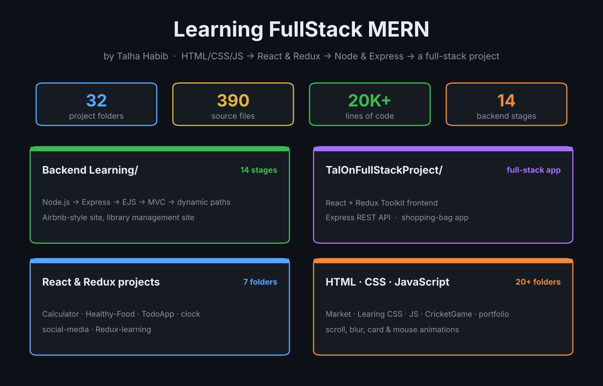
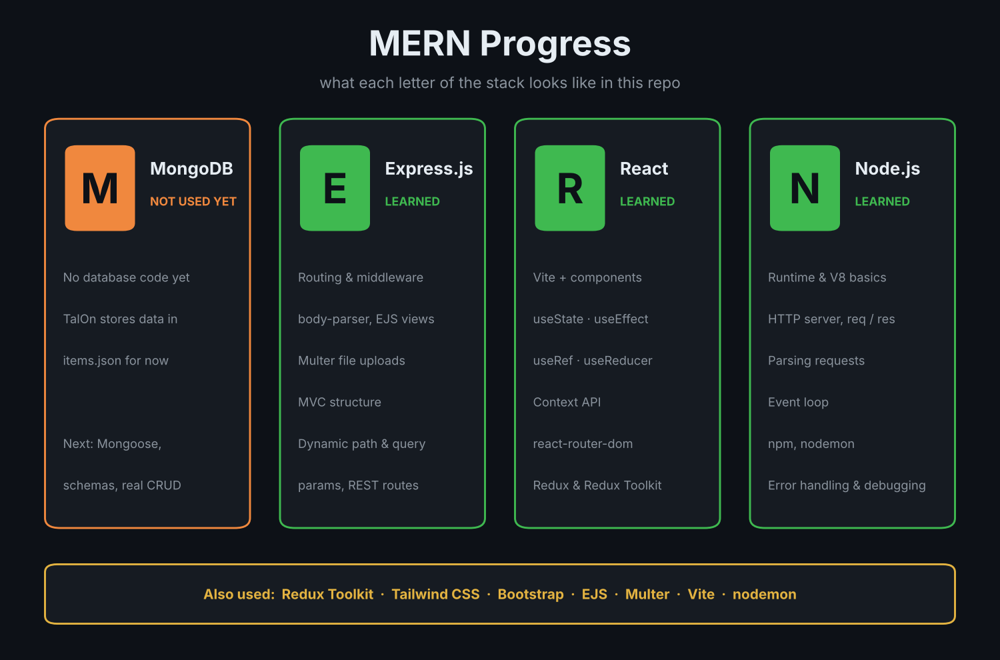
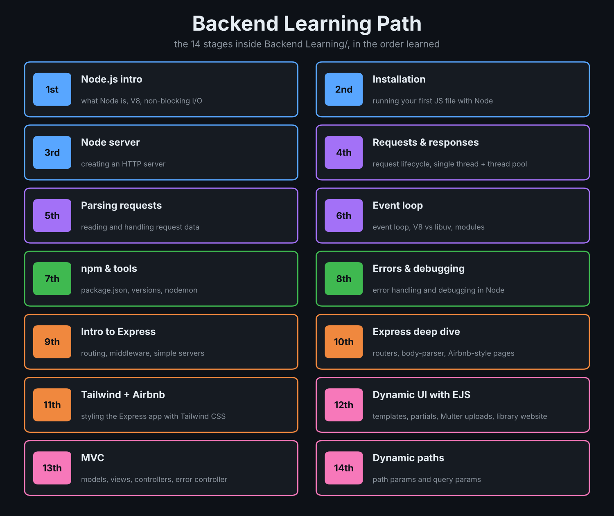
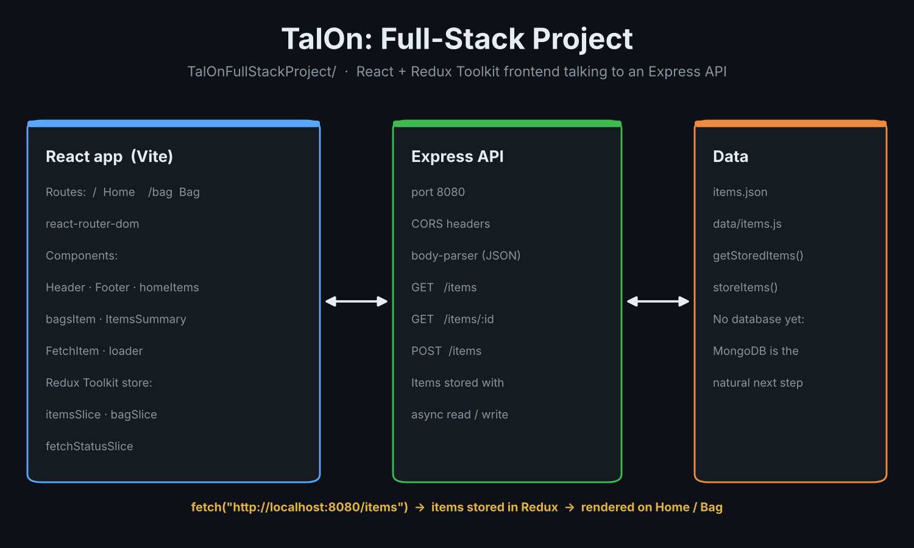

# Learning FullStack MERN



A personal learning repository documenting my journey from frontend basics to full-stack development: **32 project folders, 390 source files and 20,000+ lines of code**, covering HTML, CSS, JavaScript, React, Redux, Node.js, Express and EJS.

**Author:** Talha Habib

> This repo grows as I practice new concepts and revisit old ones.

## About

This is not a single application. It is a **collection of independent projects and mini-exercises**, each in its own folder. The folders follow my progress, from plain HTML/CSS layouts, through React and Redux, to a backend course in Node.js and Express, and finally a full-stack project that connects a React app to an Express API.

---

## MERN progress



Express, React and Node.js are all covered in the code. **MongoDB is not used yet**: the full-stack project currently stores its data in a JSON file, and adding a real database is the next step.

---

## Repository structure

### Backend Learning: Node.js & Express

[`Backend Learning/`](Backend%20Learning) holds the backend course, one folder per stage, many with a `what_learned.txt` of notes.



### Full-stack project

[`TalOnFullStackProject/`](TalOnFullStackProject) is a shopping-bag app built in stages.

| Folder | What it is |
|---|---|
| `1-pre-built-bundle` | A plain HTML/CSS/JS version (`old-clone`) plus a starter Node backend |
| `2-TalOn-react` | The React frontend: Vite, react-router-dom, Redux Toolkit |
| `2-actual-backend` | The Express API that serves the items |



### React & Redux projects

| Folder | Description |
|---|---|
| [`Calculator`](Calculator) | Calculator app built with React and Bootstrap |
| [`Healthy-Food`](Healthy-Food) | Food / health UI built with React |
| [`TodoApp`](TodoApp) | Todo list in React, with the Context API |
| [`clock`](clock) | Clock app in React |
| [`social-media`](social-media) | Social media style UI with react-router and Context |
| [`Redux-learning`](Redux-learning) | Redux practice: plain Redux, React + Redux (counter), and Redux Toolkit |

### HTML, CSS & JavaScript projects

| Folder | Description |
|---|---|
| [`Learing CSS`](Learing%20CSS) | CSS learning exercises |
| [`HTML & CSS projects`](HTML%20%26%20CSS%20projects) | Assorted HTML/CSS practice |
| [`JS`](JS) | JavaScript exercises and snippets |
| [`Market`](Market) | Market / e-commerce style UI |
| [`My portfolio`](My%20portfolio) | Personal portfolio website |
| [`CricketGame`](CricketGame) | Cricket-themed mini game |
| [`Todo App`](Todo%20App) | Todo list in plain HTML/CSS/JS (an earlier version of `TodoApp`) |
| [`chemistry department`](chemistry%20department) | UI themed around a chemistry department |
| [`voiceUsing`](voiceUsing) | Voice / speech experiment |
| [`keyCode`](keyCode) | Keyboard event experiments |
| [`Custom Checkbox`](Custom%20Checkbox) | Custom-styled checkbox component |
| [`progress`](progress) | Progress bar component |
| [`search-expands`](search-expands) | Expanding search bar |
| [`Scroll-animation`](Scroll-animation) | Scroll-triggered animations |
| [`blur-loading`](blur-loading) | Blur-effect loading screen |
| [`cards-moving`](cards-moving) | Card animation experiment |
| [`circle-folder`](circle-folder) | Circular UI animation |
| [`login-title-animation`](login-title-animation) | Animated login page title |
| [`mouse-floater`](mouse-floater) | Mouse-following effect |

*Folder names and contents may change as new projects are added.*

---

## Tech stack

| Area | Tools |
|---|---|
| **Frontend** | HTML, CSS, JavaScript, React (Vite), Bootstrap, Tailwind CSS, react-router-dom |
| **State management** | Redux, Redux Toolkit, Context API, `useState` / `useReducer` |
| **Backend** | Node.js, Express, EJS templates, body-parser, Multer (file uploads), nodemon |
| **Database** | MongoDB: planned, not used yet |

Not every folder uses the full stack. Many are frontend-only practice projects.

---

## Getting started

```bash
git clone https://github.com/TalhaHabib-hub/Learning-FullStack-MERN.git
cd Learning-FullStack-MERN
```

**Plain HTML/CSS/JS projects:** open the folder's `index.html` in your browser.

**React projects** (Calculator, TodoApp, Redux-learning, …):

```bash
cd TodoApp
npm install
npm run dev
```

**Run the TalOn full-stack project** (two terminals):

```bash
# terminal 1: API on http://localhost:8080
cd TalOnFullStackProject/2-actual-backend
npm install
npm start

# terminal 2: React app
cd TalOnFullStackProject/2-TalOn-react
npm install
npm run dev
```

**Backend Learning projects:** `cd` into a stage folder, run `npm install`, then `npm start` (or `node app.js` for the early ones). Check each folder's `package.json` for the exact script.

---

## Purpose

- A **learning log** tracking progress in frontend and full-stack development
- A **sandbox** for trying new UI ideas, animations, and JS concepts
- A **reference** for revisiting past exercises

## Contributing

This is a personal learning repository and isn't actively seeking contributions, but feel free to explore, fork, or open an issue.

## Author

**Talha Habib**: [@TalhaHabib-hub](https://github.com/TalhaHabib-hub)
